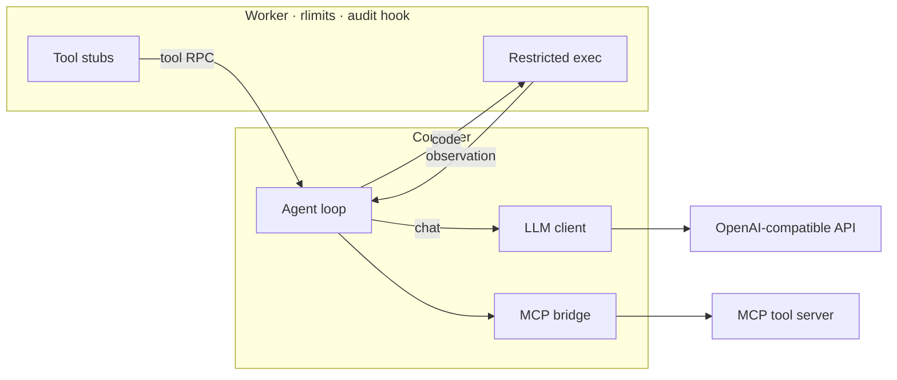

# Agent Smith

### An LLM that writes Python, not JSON tool calls. Run in a sandbox built from scratch.

<p align="center">
  
  
  
  
</p>

<p align="center">
  
  
  
  
  
</p>

Most agents ask the model to fill a JSON form. This one asks for **Python**, executes it in a process-isolated sandbox, and feeds the real stdout back as the next observation. One code block can loop, branch, and call several tools, because it is a program, not a payload.

Built without LangChain, LangGraph, LlamaIndex, smolagents, CrewAI, AutoGen, or RestrictedPython. Three runtime dependencies. 279 tests offline in about a minute.

---

## Results at a glance

Scored by a Docker grader that runs a **hidden first test** the agent never sees. Caps per task: 10 iterations · 6 000 input tokens · 1 500 output tokens · 120 s.

| | Groq<br/>`openai/gpt-oss-120b` | Gemini<br/>`gemini-3.5-flash-lite` |
|:---|:---:|:---:|
| **Grader PASS** | **9 / 10** | **5 / 5** |
| Avg iterations | 1.5 | 1.0 |
| Avg tokens (in / out) | 1000 / 621 | 554 / 169 |
| Avg wall clock | 2.8 s | 1.9 s |
| Under every cap | yes | yes |

School pass bar: 4/5. The Groq miss (task 247) hit the output-token ceiling mid-fence on a long DP solution and never called `final_answer`: a budget failure, not a wrong answer on the hidden test.

Also verified:

| Check | Result |
|---|---|
| `quickstart.sh mbpp` (fresh dump) | Overall: PASSED |
| Task 11 · Groq · Docker validate | Correctness PASSED · Metrics VALID |
| Task 11 · scripted local provider (no API key) | 1 iter · 620 / 180 tokens · 0.7 s · All checks passed |
| Forced `SIGTERM` at 5 s | Valid `solution.json` · exit 124 · no orphan processes |
| Stuck-run guard | 7 iter / 4340 tokens → **4 / 2480** (−43%) |

---

## Architecture



| Boundary | Rule |
|---|---|
| Worker | Never holds API keys, never opens the network |
| Controller | Never executes model-written code |
| Tool calls | Routed through the controller; tool latency does **not** consume the sandbox timer |

---

## Engineering highlights

<table>
<tr>
<td width="50%">

**Sandbox (23 escape tests)**  
AST denylist · import allowlist · path guard · [PEP 578](https://peps.python.org/pep-0578/) audit hook · `setrlimit` memory/CPU · soft `SIGALRM` then hard kill + respawn · cleared worker environment.

</td>
<td width="50%">

**Agent loop**  
Budget checked *before* each LLM call · `max_tokens` clamped to remaining output · four answer formats (Python / XML / Hermes / ReAct) · stuck-code early stop · atomic `solution.json` after every step.

</td>
</tr>
<tr>
<td width="50%">

**Provider layer (48 tests)**  
OpenAI-compatible HTTP · multi-key rotation · `Retry-After` · deadline-bounded backoff · injected transport/clock so rate-limit paths are tested without a network.

</td>
<td width="50%">

**MCP inside the sandbox**  
Async SDK behind a sync API · tools appear as real Python functions with signatures · `repr()` for injection-safe argument codegen (AST-asserted).

</td>
</tr>
</table>

### What the sandbox actually says

```text
import socket                           →  import of 'socket' is not allowed
open('/etc/passwd').read()              →  access denied (allowed: /testbed, /tmp/agent)
import random; random._os.system('id')  →  os.system is not allowed in the sandbox
print.__self__                          →  access to '__self__' is not allowed
[0] * (10 ** 9)                         →  MemoryError: memory limit exceeded
while True: pass                        →  Timeout (output + variables kept)

import random; len(random._os.environ)  →  0
import math; math.factorial(10)         →  3628800
```

---

## Test coverage

| Area | Tests |
|---|---:|
| Provider layer (retries, rotation, deadlines) | 48 |
| Sandbox policy (imports, builtins, paths, AST) | 44 |
| Code extraction (4 formats) | 36 |
| Agent loop, budget, trace file | 30 |
| Sandbox escape attempts | 23 |
| MCP inside the sandbox | 22 |
| CLI + SIGTERM | 22 |
| Controller, respawn, timeouts | 19 |
| Runtime + wire protocol | 17 |
| MBPP tool server | 10 |
| Config + models | 8 |
| **Total** | **279** |

---

## Quick start

```bash
uv sync
cp .env.example .env   # add GROQ_API_KEY / GEMINI_API_KEY / …

uv run sandbox                              # REPL: try to escape it
uv run pytest -q                            # 279 offline
uv run python -m agent_mbpp \
  --task-file task.json --output solution.json
```

Batch a graded run (needs Docker + moulinette sibling):

```bash
scripts/run_mbpp_batch.sh 10 \
  --model-name openai/gpt-oss-120b \
  --provider-url https://api.groq.com/openai/v1 \
  --moulinette ../moulinette
```

---

## Layout

```
agent_smith/
  sandbox/       policy · audit hook · worker · controller · REPL
  llm/           OpenAI-compatible client · key pool · retries
  agent/         loop · budget · extraction · prompts · trace writer
  mcp_client/    sync bridge over the async MCP SDK
agent_mbpp/      benchmark CLI the grader invokes
mcp_tools_mbpp.py
configs/         providers.json · agent_mbpp.json
scripts/         mcp_probe · llm_ping · run_mbpp_batch.sh · …
tests/           2.9k lines, including a scripted local provider
```

The loop takes a system prompt, a task message, and a sandbox. Benchmark knowledge stays out of the core. SWE-bench is a new tool server and CLI, not a new agent.

---

## Constraints that shaped the design

- No agent framework (listed by name in the assignment)
- Free-tier APIs only → key rotation and deadline-bounded retries
- Python 3.10 stdlib for the sandbox (no RestrictedPython)
- Honest traces: the grader consistency-checks every `solution.json`

`agent_smith/models_public.py` is the grader schema, copied verbatim so output cannot drift from the contract.
